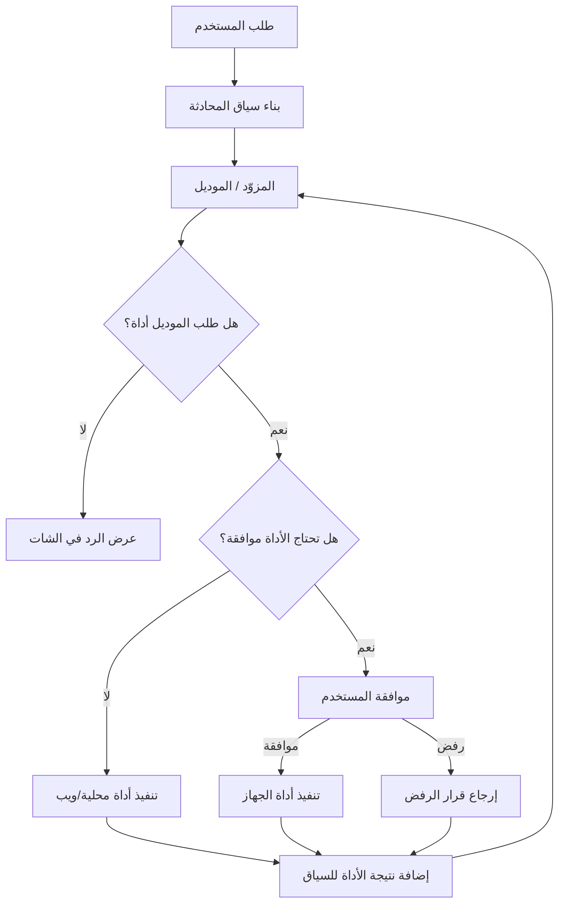

<div align="center">


# ⚡ OneByte Agent

### مساعد Android ذكي — Neon Intelligence. Electric Tools. Your Device, Your Control.

**OneByte Agent** وكيل Android يعمل بالشات والصوت والذاكرة والمهارات والمهام، ويتيح أدوات ويب وتحكمًا اختياريًا بالهاتف، ومركزًا لفتح حسابات التسويق، ومختبرًا يوجّه المتصفح المدمج لقراءة الصفحات والتفاعل معها وإجراء اختبارات HTTP محددة داخل نطاقات مصرح بها.

[](https://github.com/elssoliman86-codesoli/onebyte-agent/actions/workflows/build-apk.yml)
[](https://github.com/elssoliman86-codesoli/onebyte-agent/releases)
[](https://github.com/elssoliman86-codesoli/onebyte-agent)
[](https://www.typescriptlang.org/)
[](./LICENSE)

**[⬇️ تنزيل APK — OneByte Agent v1.4.1](https://github.com/elssoliman86-codesoli/onebyte-agent/releases/download/v1.4.1/onebyte-agent-v1.4.1.apk) · [📦 تفاصيل الإصدار v1.4.1](https://github.com/elssoliman86-codesoli/onebyte-agent/releases/tag/v1.4.1) · [🧾 سجل التغييرات](https://github.com/elssoliman86-codesoli/onebyte-agent/commits/main) · [🐞 الإبلاغ عن مشكلة](https://github.com/elssoliman86-codesoli/onebyte-agent/issues)**

</div>

---

<div dir="rtl">

## ⚡ فكرة المشروع

**OneByte Agent** تطبيق Android مبني باستخدام Expo وReact Native وTypeScript. بدل ما يكون مجرد شات، فهو يشغّل حلقة وكيل (Agent Loop) تستطيع فيها النماذج المتوافقة مع واجهة OpenAI أن تطلب أدوات محددة، وينفّذ التطبيق الأدوات وفقًا لقواعد الموافقة والصلاحيات.

هو مشروع **Local-first**: بيانات المحادثات والمهارات والذاكرة تُدار محليًا على الجهاز، لكن هذا لا يعني أن كل البيانات تبقى على الهاتف دائمًا؛ نصوص المحادثات التي ترسلها إلى الموديل تذهب إلى مزوّد الذكاء الاصطناعي الذي تختاره، وأدوات الويب والتكاملات الخارجية تتصل بخدماتها عند استخدامها.

### 🌩️ الهوية البصرية: Electric Spiderweb

الرسم الموجود أعلى الصفحة هو عنصر الهوية الأساسي للمشروع: شبكة كهربائية حول نواة مركزية، ومسارات مضيئة مستوحاة من **Neon Cyan / Electric Blue / Lightning Red**. الفكرة البصرية تعكس ارتباط أجزاء التطبيق ببعضها:

- ⚡ **Model** — الموديل الذي يفهم الطلب ويقترح الخطوات.
- 🔌 **Tools** — الأدوات التي تنفّذ عمليات محددة.
- 🧠 **Memory** — سياق محلي يساعد على الاحتفاظ بالمعلومات المهمة.
- 🛡️ **Approval** — طبقة تحكّم للموافقة على إجراءات الهاتف الحساسة.

</div>

## 🧭 المحتويات

- [المزايا](#-المزايا)
- [مساحات العمل](#-مساحات-العمل)
- [طريقة تنظيم المشروع](#-طريقة-تنظيم-المشروع)
- [التثبيت والتشغيل](#-التثبيت-والتشغيل)
- [الإعداد الأول](#-الإعداد-الأول)
- [الأدوات والأوامر](#-الأدوات-والأوامر)
- [الخصوصية والأمان](#-الخصوصية-والأمان)
- [القيود المعروفة](#-القيود-المعروفة)
- [البناء والتحقق](#-البناء-والتحقق)
- [المساهمة والترخيص](#-المساهمة-والترخيص)

---

<div dir="rtl">

## ✨ المزايا

### 💬 الشات والذكاء الاصطناعي

- بث مباشر للردود (Streaming) من مزوّدي النماذج المتوافقين مع OpenAI Chat Completions.
- حلقة أدوات: يمكن للموديل طلب أداة، انتظار النتيجة، ثم متابعة الرد.
- إعداد عنوان API واسم الموديل والمفتاح، مع قوالب لمزوّدين متعددين ودعم نقاط النهاية المتوافقة.
- فحص اتصال الموديل ومساعدة في فهم أخطاء HTTP الشائعة مثل `401` و`404` و`429`.
- دعم إرفاق الصور والملفات في مسار الشات، بحسب نوع الملف والموديل المستخدم وقدرات المزوّد.
- إيقاف الطلب الجاري من واجهة الشات، بما في ذلك انتظار الموديل والمهام التي تدعم الإلغاء.
- دعم الرسائل التي تحتوي على نصوص متعددة الأسطر وصور متعددة، مع محاولة التعامل مع الطلبات الطويلة عبر تقسيم النص أو تلخيصه داخليًا عند الحاجة. يظل التنفيذ محدودًا بسياق الموديل وحدود المزوّد.
- واجهة شات مُحسّنة: رأس مضغوط، سجل محادثات في الدرج الجانبي، فقاعة مستخدم بعرض مناسب للنص، وإجراءات للنسخ والتعديل، مع إجراءات أيقونية لرسائل المساعد.

### 🧠 الذاكرة والمهارات والسياق

- حفظ معلومات مختارة في ذاكرة محلية يمكن للأدوات الرجوع إليها.
- حفظ المهارات وقراءة التعليمات الكاملة لمهارة عند الحاجة.
- بحث في المحادثات المحفوظة، بما في ذلك المحتوى الذي لم يعد ظاهرًا بالكامل في سياق الموديل.
- تلخيص أجزاء من سياق المحادثة للمساعدة في التعامل مع المحادثات الطويلة.
- مهام يومية وتذكيرات محلية يمكنها فتح الطلب المرتبط بها داخل الشات.

### 📱 أدوات الهاتف — عند تفعيلها فقط

يمكن لخدمة Android الأصلية استخدام Accessibility لتنفيذ عمليات مسموحة داخل الهاتف، مثل:

- قراءة عناصر واجهة الشاشة الحالية.
- فتح تطبيق أو رابط.
- الضغط على عنصر، وكتابة نص في حقل عادي، والتمرير.
- تنفيذ بعض مفاتيح النظام والانتظار حتى تستقر الشاشة.
- عرض طلبات الموافقة قبل استخدام أدوات قراءة الجهاز أو التأثير عليه.

التحكم في الهاتف **اختياري**، ويتطلب تثبيت نسخة Android مبنية مع الوحدة الأصلية ثم تفعيل خدمة إمكانية الوصول من إعدادات النظام. هذه الوظائف لا تعمل بالكامل داخل Expo Go.

### 🌐 أدوات الويب والمتصفح المدمج

- البحث في الويب باستخدام DuckDuckGo وجلب محتوى صفحة عامة عندما يطلب المستخدم ذلك.
- في نسخة Android، يستطيع الوكيل توجيه WebView المدمج لفتح رابط مصرح به، وقراءة عنوان الصفحة ونصها والعناصر التفاعلية، والنقر والكتابة في الحقول غير الحساسة، والتمرير والانتظار.
- يمكنه إرسال طلبات HTTP محددة من سياق الصفحة وتحليل status وheaders والجسم وزمن الاستجابة، ثم استخدام نتيجة الأداة لمتابعة الاستدلال.
- أدوات المتصفح لا تعترض حركة المتصفح ولا تنشئ Proxy؛ إنها تنفذ الأفعال المطلوبة داخل المتصفح المدمج نفسه.

### 🧩 عرض المحتوى

- عرض Markdown بعناوين وقوائم بدل عرضه كنص خام.
- تنسيق كتل الكود مع إمكانية نسخها، ودعم تنزيل كتل الكود كملف عند توفر الإجراء في الواجهة.
- عرض مخططات Mermaid، مع مراعاة ألوان `classDef` و`class` و`:::` الموجودة في المصدر.
- معاينة Mermaid بمحرك Mermaid الأصلي في العرض المدعوم داخل التطبيق/الويب.
- معاينة HTML داخل WebView مع إمكانية إعادة التحميل أو فتحها في المتصفح عند توفرها.
- دعم الثيم الفاتح والداكن والتلقائي.

### 💻 واجهة الكمبيوتر المصاحبة

يمكن تشغيل خادم PC من إعدادات التطبيق ثم فتح عنوانه من متصفح كمبيوتر على **نفس شبكة Wi-Fi**. يسجّل المستخدم الدخول باستخدام PIN، وتظل موافقات إجراءات الهاتف الحساسة مرتبطة بالجهاز.

> استخدم هذه الواجهة على شبكة موثوقة فقط. الخادم المحلي ليس بديلًا عن نشر خدمة آمنة على الإنترنت، ولا ينبغي فتح منفذه للعامة أو تحويله مباشرة إلى عنوان عام.

### 🛠️ مساحات عمل متخصصة

- **Developer Lab:** مساحة لتجارب وتحرير المحتوى البرمجي وبعض أدوات المعاينة.
- **Marketing Studio:** مركز سريع لفتح حسابات YouTube Studio وTikTok وFacebook وInstagram وWhatsApp Web/Desktop وTelegram Web، مع فتح مساعد التسويق لكتابة المحتوى وخطط الحملات.
- **Cybersecurity Lab / Bug Hunter:** إدارة نطاقات الاختبار، وتحرير طلب HTTP (GET/POST/PUT/PATCH/DELETE/HEAD/OPTIONS)، وتعديل headers/body، وإرسال الطلب أو إلغاؤه، وقراءة status/الوقت/مقتطف الاستجابة، والرجوع إلى سجل الطلبات.
- **اختبار ويب من المتصفح المدمج:** عند طلب اختبار هدف مصرح به، يرجع الموديل إلى المهارات المحفوظة — ومنها مهارة اختبار أمن الويب وأي مهارة متخصصة بنوع الثغرة — ثم يوجّه WebView لقراءة الصفحة والتفاعل معها وإرسال طلبات اختبار محددة وتحليل الردود. تُعاد نتائج الأدوات إلى سياق الموديل كي يقرر الخطوة التالية. لا يستخدم Proxy أو اعتراض حركة المتصفح.

**حسابات التسويق:** افتح المنصة وسجّل الدخول بنفسك عند الحاجة. تظل الجلسات والصلاحيات بيد المستخدم؛ لا نخزن كلمات مرور الشبكات الاجتماعية ولا نتجاوز تسجيل الدخول. النشر الآلي يعتمد على واجهة API رسمية وصلاحيات التطبيق المطلوبة؛ فتح الموقع لا يعني أن النشر التلقائي متاح. تيليجرام لديه تكامل Bot API في الحالات المدعومة.

</div>

---

<div dir="rtl">

## 🧱 طريقة تنظيم المشروع

الكود منظّم إلى طبقات حتى يكون فصل الواجهة عن منطق الوكيل والتخزين والوحدات الأصلية واضحًا:

</div>

```text
onebyte-agent/
├── app/
│   └── (tabs)/                 # شاشات التطبيق ومسارات Expo Router
│       ├── index.tsx           # الشات وتجربة الوكيل
│       ├── settings.tsx        # إعداد المزوّد وخيارات التطبيق
│       ├── tasks.tsx           # المهام والتذكيرات
│       ├── skills.tsx          # إدارة المهارات
│       ├── memory.tsx          # الذاكرة المحلية
│       ├── lab.tsx             # Developer Lab
│       ├── marketing.tsx       # Marketing Studio
│       ├── hunter.tsx          # Bug Hunter
│       ├── approvals.tsx       # طلبات الموافقة
│       ├── findings.tsx        # نتائج وأدلة الاختبار
│       └── assessments.tsx     # تقييمات/مراجعات مرتبطة بمساحات العمل
├── components/
│   └── desktop/                # مكونات واجهة الكمبيوتر وتقسيماتها
├── constants/                  # ثوابت الواجهة والتصميم
├── hooks/                      # React hooks
├── modules/
│   ├── device-control/         # وحدة Expo أصلية لـ Android والتحكم بالجهاز
│   └── speech-recognition/     # وحدة Expo أصلية للتعرف على الكلام
├── src/
│   ├── agent.ts                # حلقة الوكيل واستقبال ردود الأدوات
│   ├── embedded-browser.ts     # واجهة ربط أدوات الوكيل بالمتصفح المدمج
│   ├── assistant.tsx           # نماذج البيانات وحالة التطبيق
│   ├── model-provider.ts       # الاتصال بالموديلات وصياغة رسائل المزوّد
│   ├── model-catalog.ts        # اكتشاف الموديلات ومعلوماتها
│   ├── provider-presets.ts     # قوالب إعداد المزوّدين
│   ├── tools.ts                # تعريف الأدوات ومجموعاتها والموافقة عليها
│   ├── context.ts              # تقدير حجم السياق والتلخيص
│   ├── storage.ts              # التخزين المحلي والترحيلات
│   ├── device.ts               # واجهة ربط TypeScript بوظائف الجهاز
│   ├── pc-server.ts            # منطق خادم الكمبيوتر المصاحب
│   ├── speech-recognition.ts   # واجهة التعرف على الكلام
│   ├── speech-service.ts       # طبقة خدمة الصوت
│   ├── task-reminders.ts       # جدولة التذكيرات
│   ├── knowledge.ts            # التعامل مع المعرفة المحفوظة
│   ├── core-skills.ts          # المهارات الأساسية
│   ├── marketing.ts            # منطق Marketing Studio
│   ├── hunter.ts               # منطق Bug Hunter ونطاقات الاختبار
│   ├── project-workspace.ts    # بيانات مساحة العمل
│   ├── workspace.tsx           # مكونات/تجربة مساحة العمل
│   ├── fetch-with-retry.ts     # اتصالات HTTP وإعادة المحاولة
│   ├── github.ts               # تكامل GitHub
│   └── i18n.ts                 # نصوص وترجمات الواجهة
├── server/
│   ├── serve.js                # تقديم نسخة الويب المبنية
│   └── templates/              # قوالب صفحات الويب
├── scripts/
│   └── build.js                # خطوات بناء المشروع
├── .github/
│   ├── assets/
│   │   └── electric-spiderweb.svg # رسم الهوية الكهربائي
│   └── workflows/
│       └── build-apk.yml       # بناء APK تلقائيًا
├── app.json                    # إعداد Expo وAndroid
├── package.json                # الاعتماديات والأوامر
├── package-lock.json           # تثبيت نسخ الاعتماديات
├── tsconfig.json               # إعداد TypeScript
├── BUILD_AR.md                 # دليل بناء Android بالعربية
├── CODE_REVIEW_REPORT.md       # تقرير مراجعة الكود
└── LICENSE                     # ترخيص MIT
```

<div dir="rtl">

### 🔁 تدفّق الطلب داخل الوكيل

</div>



---

<div dir="rtl">

## 📥 التثبيت والتشغيل

### الخيار الأول: تنزيل APK جاهز

1. افتح [صفحة الإصدارات Releases](https://github.com/elssoliman86-codesoli/onebyte-agent/releases/latest).
2. نزّل ملف APK المرفق بآخر إصدار منشور.
3. افتح الملف على هاتف Android واسمح بالتثبيت من المصدر عند ظهور طلب النظام.
4. افتح التطبيق وأكمل إعداد المزوّد.

**مهم:** آخر إصدار منشور قد يكون أقدم من الكود الموجود على فرع `main`. آخر إصدار منشور ظهر أثناء تحديث هذا الملف هو **v1.4.1**؛ أما تحسينات الواجهة اللاحقة في `main` فتحتاج بناء أحدث حتى تصل إلى APK.

### الخيار الثاني: تشغيل نسخة التطوير

المتطلبات الأساسية:

- Node.js 20 أو إصدار متوافق مع اعتماديات المشروع.
- npm.
- Android Studio وAndroid SDK عند البناء المحلي.
- Java 17 لبناء Android.

استنسخ المستودع وثبّت الاعتماديات:

```bash
git clone https://github.com/elssoliman86-codesoli/onebyte-agent.git
cd onebyte-agent
npm ci
npm run typecheck
npx expo start
```

تشغيل `npx expo start` مناسب للتطوير وتجربة الواجهات، لكن **Expo Go لا يوفّر الوحدات الأصلية المخصصة للتحكم بالجهاز والتعرف على الكلام**. لاختبار هذه الوظائف استخدم APK مبنيًا من المشروع.

### الخيار الثالث: بناء APK محليًا

بعد تثبيت Android Studio وJava وتهيئة Android SDK:

```bash
npx expo prebuild --platform android --clean
cd android
./gradlew assembleRelease
```

على Windows استخدم:

```powershell
npx expo prebuild --platform android --clean
cd android
.\gradlew.bat assembleRelease
```

المسار المتوقع لملف APK بعد نجاح البناء:

```text
android/app/build/outputs/apk/release/app-release.apk
```

### الخيار الرابع: البناء عبر GitHub Actions

المستودع يحتوي على Workflow باسم **Build Android APK** يعمل عند الدفع إلى `main` أو عند تشغيله يدويًا من تبويب Actions. الـWorkflow الحالي يثبّت الاعتماديات، وينشئ مشروع Android، ويبني Release APK ثم يرفعه كـArtifact.

- [فتح GitHub Actions](https://github.com/elssoliman86-codesoli/onebyte-agent/actions)
- [فتح ملف إعداد البناء](./.github/workflows/build-apk.yml)

نجاح البناء يثبت أن خطوة إنشاء APK اكتملت؛ لكنه لا يغني عن تجربة التطبيق على هاتف Android فعلي.

</div>

---

<div dir="rtl">

## 🚀 الإعداد الأول

### 1. إعداد مزوّد الذكاء الاصطناعي

من **الإعدادات**:

1. اختر مزوّدًا جاهزًا أو أدخل عنوان Base URL المتوافق مع OpenAI.
2. أدخل مفتاح API إذا كان المزوّد يتطلب مفتاحًا.
3. اختر اسم الموديل الصحيح.
4. افحص الاتصال وجرّب طلبًا نصيًا بسيطًا قبل تفعيل الأدوات.

قد تختلف أسماء المسارات والموديلات المدعومة بين المزوّدين. إذا ظهر خطأ، راجع عنوان API والمفتاح وحدود الاستخدام ودعم الموديل لاستدعاء الأدوات والصور.

### 2. تفعيل التحكم الاختياري في الهاتف

1. افتح الإعدادات داخل التطبيق.
2. فعّل خيار التحكم بالجهاز.
3. افتح إعدادات إمكانية الوصول في Android.
4. اختر خدمة OneByte Agent وفعّلها بعد قراءة تحذير النظام.

Android يعرض تحذيرات خاصة بخدمات إمكانية الوصول لأنها قادرة على قراءة عناصر الشاشة وتنفيذ إجراءات فيها. فعّلها فقط إذا كنت تثق بالتطبيق وتفهم الصلاحيات التي تمنحها. يمكنك تعطيلها من إعدادات النظام في أي وقت.

### 3. تجربة الشات

ابدأ بسؤال نصي بسيط، وبعد التأكد من عمل الموديل جرّب أداة قراءة ويب أو مهمة محلية. عند استخدام أدوات الجهاز، راجع تفاصيل الإجراء في شاشة الموافقة قبل السماح به.

### 4. فتح نسخة الكمبيوتر

1. افتح إعدادات التطبيق وابحث عن إعداد خادم الكمبيوتر.
2. شغّل الخادم وسجّل عنوان الشبكة والمنفذ المعروض.
3. افتح العنوان من متصفح كمبيوتر على الشبكة المحلية نفسها.
4. أدخل PIN الظاهر في التطبيق.

عنوان الخادم والمنفذ قد يختلفان وفق الإعدادات الحالية؛ اعتمد القيمة التي يعرضها التطبيق بدل افتراض عنوان ثابت.

</div>

---

<div dir="rtl">

## 🧰 الأدوات والأوامر

### مجموعات الأدوات

| المجموعة | أمثلة | السلوك المتوقع |
|---|---|---|
| محلية | قراءة مهارة، البحث في المحادثات، الانتظار | تعمل على بيانات/حالة التطبيق المحلية |
| الذاكرة والمهام | حفظ معلومة، إنشاء تذكير | تحفظ محليًا وتحدّث بيانات التطبيق |
| الويب | بحث عام، جلب صفحة عامة | تحتاج اتصالًا بالإنترنت وقد تتأثر بقيود الموقع |
| المتصفح المدمج | فتح وقراءة الصفحة، النقر، كتابة نص غير حساس، التمرير، إرسال طلب HTTP ضمن النطاق | أدوات Android؛ نطاق محفوظ مطلوب، وقيود CORS وسياسات الموقع قائمة |
| قراءة الجهاز | قراءة عناصر الشاشة، قائمة التطبيقات | تخضع لمفتاح التحكم وموافقة المستخدم |
| إجراءات الجهاز | فتح تطبيق/رابط، الضغط، الكتابة، التمرير، مفاتيح النظام | تتطلب تفعيل الخدمة ومراجعة طلب الموافقة |

### أوامر الشات

توفّر الواجهة أوامر سريعة مثل:

| الأمر | الاستخدام |
|---|---|
| `/help` | المساعدة والأوامر المتاحة |
| `/skill اسم` | اختيار مهارة بالاسم |
| `/mcp` | عرض معلومات الأدوات/الاتصالات المتاحة |
| `/new` | بدء محادثة جديدة |
| `/settings` | الانتقال إلى الإعدادات |
| `/tasks` | فتح المهام |
| `/skills` | فتح المهارات |
| `/memory` | فتح الذاكرة |

> قد تتغير تفاصيل الأوامر أو طريقة عرضها مع تحديثات الواجهة؛ راجع `/help` داخل النسخة المثبّتة.

</div>

---

<div dir="rtl">

## 🔐 الخصوصية والأمان

- **اختيار المزوّد مسؤولية المستخدم:** الرسائل التي ترسلها إلى الموديل تنتقل إلى الجهة التي توفر هذا الموديل، وتخضع لشروطها وسياسة الاحتفاظ بالبيانات لديها.
- **تخزين محلي:** يحتفظ التطبيق ببيانات مثل المحادثات والذاكرة والمهارات في التخزين المحلي. احمِ هاتفك ونسخه الاحتياطية.
- **مفاتيح API:** يستخدم المشروع `expo-secure-store` لحفظ سرّ المزوّد الخاص بالشات. لا تشارك ملفات النسخ الاحتياطي أو بيانات الإعداد التي تحتوي على أسرار.
- **موافقات أدوات الجهاز:** أدوات قراءة الشاشة أو تنفيذ إجراءات على الهاتف مصنفة بشكل منفصل عن الأدوات المحلية وأدوات الويب، وتحتاج قرار موافقة وفق تدفق التطبيق.
- **الحقول الحساسة:** منطق التحكم بالجهاز مصمم لإخفاء بيانات حقول كلمات المرور ورفض الكتابة فيها، لكن لا تعتمد على ذلك وحده لحماية المعلومات الحساسة.
- **خادم الكمبيوتر:** استخدمه على شبكة موثوقة، ولا تعرض المنفذ للإنترنت العام. PIN وسيلة وصول وليست بديلًا عن النقل المشفّر وإعدادات الشبكة الآمنة.
- **Cybersecurity Lab:** اختبر فقط نطاقات تملكها أو تسمح بها سياسة برنامج Bug Bounty مثل HackerOne. أضف النطاق المسموح به ومصدر الإذن قبل الإرسال، وتأكد من النطاقات الفرعية المستثناة وقواعد البرنامج. التطبيق يقيّد الإرسال إلى النطاق الذي أضفته، لكن ذلك لا يغني عن مراجعة قواعد البرنامج أو عن استخدام بيئة اختبار مناسبة.
- **تكاملات الطرف الثالث:** GitHub وTelegram وأي خدمات أخرى تستخدمها تتبع صلاحيات التوكن الذي تقدمه لها. أنشئ رموزًا بأقل صلاحيات ممكنة وألغها عند عدم الحاجة.

</div>

---

<div dir="rtl">

## ⚠️ القيود المعروفة

- **توافق الموديلات:** ليس كل موديل يدعم Tool Calling أو الصور أو نفس صيغة Streaming. قد يحتاج بعض المزوّدين إلى إعداد مختلف.
- **الاتصال بالويب:** بعض المواقع تمنع الطلبات الآلية أو تتطلب تسجيل الدخول. لا تتوقع أن تعمل قراءة كل رابط.
- **Android:** التحكم الحقيقي بالهاتف يعتمد على وحدة Android الأصلية وصلاحيات النظام، ولا يعمل كاملًا داخل Expo Go أو في متصفح عادي.
- **OmniRoute على Android:** يسمح `plugins/withAndroidLocalHttp.js` باتصال HTTP للـ hosts المدرجة فقط في `allowedHosts` داخل `app.json`؛ باقي الوجهات تظل محمية بسياسة HTTPS الافتراضية. إذا تغيّر IP الكمبيوتر، حدّث القائمة وأعد بناء APK لأن سياسة الشبكة جزء من التطبيق الأصلي.
- **كمبيوتر مصاحب:** الواجهة تعتمد على اتصال محلي بين الكمبيوتر والهاتف، ولا تُعد خدمة عامة منشورة على الإنترنت.
- **حدود اختبار المتصفح:** لا يوجد Proxy ولا اعتراض لحركة المتصفح. الطلبات تُنفّذ من داخل WebView المدمج وتظل خاضعة لسياسات المتصفح مثل same-origin وCORS؛ التنقل وإرسال الطلبات مقيدان بالنطاق المضاف في Cybersecurity Lab. يجب تسجيل الدخول يدويًا عند الحاجة، ولا تنفّذ المهارات عمليات حذف أو دفع أو تغيير بيانات فعلية.
- **النشر عبر المنصات:** اختصارات التسويق تفتح المواقع الرسمية؛ بعض التطبيقات لا تشارك جلسة تسجيل الدخول بين المتصفح المدمج والتطبيق المستقل. النشر الآلي لا يعمل إلا للتكاملات الرسمية المهيأة.
- **النسخة المنشورة مقابل `main`:** قد تحتوي الشفرة الأحدث على تغييرات واجهة أو إصلاحات لم تُنشر بعد في Release APK.

</div>

---

<div dir="rtl">

## 🧪 البناء والتحقق

الأوامر الأساسية للتحقق محليًا:

</div>

```bash
npm ci
npm run typecheck
```

<div dir="rtl">

لبناء APK على نفس بيئة GitHub Actions، استخدم Java 17 وأنشئ مشروع Android ثم نفّذ مهمة Gradle المذكورة أعلاه.

سجل البناء:

- [حالة Workflow وآخر النتائج](https://github.com/elssoliman86-codesoli/onebyte-agent/actions)
- [آخر commits على main](https://github.com/elssoliman86-codesoli/onebyte-agent/commits/main)
- [الإصدارات المنشورة](https://github.com/elssoliman86-codesoli/onebyte-agent/releases)

وقت إعداد هذا الملف، كان هناك Workflow حديث قيد التنفيذ؛ لذلك لا يفترض هذا الـREADME أن آخر تعديل قد اجتاز البناء أو الاختبار على هاتف فعلي إلا بعد ظهور نتيجة نهائية والتجربة.

</div>

---

<div dir="rtl">

## 🗺️ آخر التحديثات على فرع main

آخر التحديثات المدمجة حتى **29 أكتوبر 2026** تشمل:

- تحسين شكل فقاعات المستخدم وإضافة إجراءات النسخ والتعديل.
- تسطيح ردود المساعد وإظهار إجراءاتها على شكل أيقونات.
- تحسين توزيع أدوات كتابة الرسالة؛ زر الإرسال على اليمين وأدوات الميكروفون والإضافة على اليسار.
- تحسين عرض مخططات Mermaid، مع استخدام ألوان المصدر ومعاينة أنظف.
- جعل فتح الشات بعد أول إرسال أسرع، ونقل ساعة سجل المحادثات إلى الدرج الجانبي.
- ضغط رأس الشات ووضع عنوان الجلسة والإجراءات في صف واحد.
- إزالة مهلات زمنية ثابتة لبعض طلبات الموديل الطويلة مع إبقاء إمكانية إلغاء الطلب من المستخدم.
- تحسينات المحادثة الصوتية المستمرة وإعادة الاستماع بعد الرد مع الحفاظ على شكل الدائرة الأصلي.
- إصلاحات تنقّل الشات والقائمة الجانبية، وتثبيت الشريط العلوي في الذاكرة والمهارات والمهام.
- مركز لفتح YouTube Studio وTikTok وFacebook وInstagram وWhatsApp Web/Desktop وTelegram Web.
- مختبر أمن سيبراني لطلبات HTTP ضمن النطاقات المصرّح بها، وسجل الاستجابات.
- ربط مهارات أمن الويب بالمتصفح المدمج حتى يقرأ الموديل الصفحة ويستخدم نتائج الأدوات في خطوات الاختبار التالية.
- إصلاحات سابقة مرتبطة بالتحكم بالجهاز، وإعداد المزوّد، وملف القفل الخاص بـnpm.

هذه قائمة موجزة من رسائل commits، وليست ضمانًا بأن كل حالة تم اختبارها على جهاز فعلي. راجع سجل GitHub للحصول على التفاصيل الدقيقة لكل تغيير.

</div>

---

<div dir="rtl">

## 🤝 المساهمة والإبلاغ عن المشاكل

- افتح [Issue](https://github.com/elssoliman86-codesoli/onebyte-agent/issues) مع وصف واضح للمشكلة، وطريقة إعادة إنتاجها، ورسالة الخطأ إن وجدت.
- عند اقتراح تعديل، اشرح سبب التغيير واختبر المسارات التي تأثرت به.
- لا ترفع مفاتيح API أو PIN أو توكنات شخصية أو سجلات تحتوي على بيانات خاصة.
- قبل إرسال Pull Request، شغّل `npm run typecheck` وابنِ APK إذا كان التغيير يمس Android أو الوحدات الأصلية.

## 📄 الترخيص

المشروع مرخّص بموجب **MIT License**. راجع [LICENSE](./LICENSE) للتفاصيل.

<div align="center">

### ⚡ Think Neon. Build Electric. Stay in Control. 🌩️

**OneByte Agent — أدواتك متصلة، وقرار التنفيذ يظل لك.**

[⭐ اترك نجمة للمشروع](https://github.com/elssoliman86-codesoli/onebyte-agent) · [📦 آخر إصدار](https://github.com/elssoliman86-codesoli/onebyte-agent/releases/latest) · [🐞 الإبلاغ عن مشكلة](https://github.com/elssoliman86-codesoli/onebyte-agent/issues)

</div>

</div>