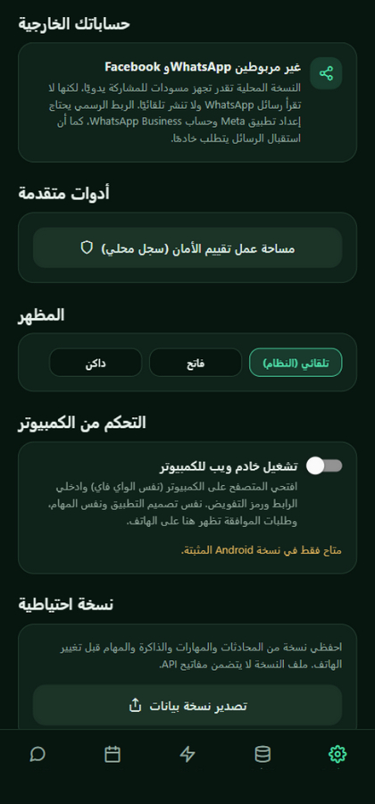
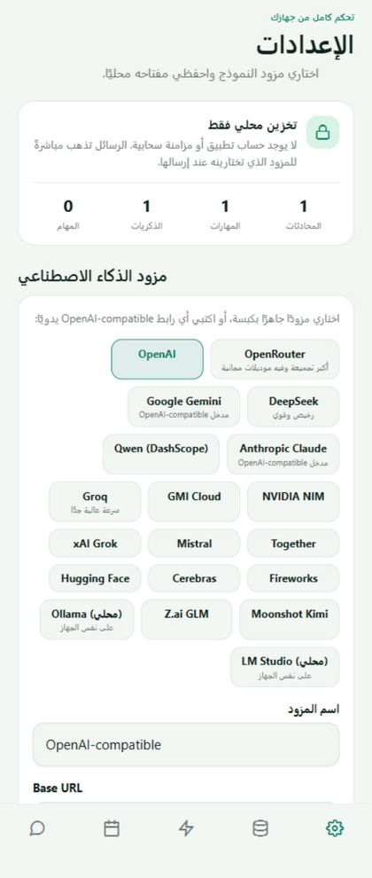
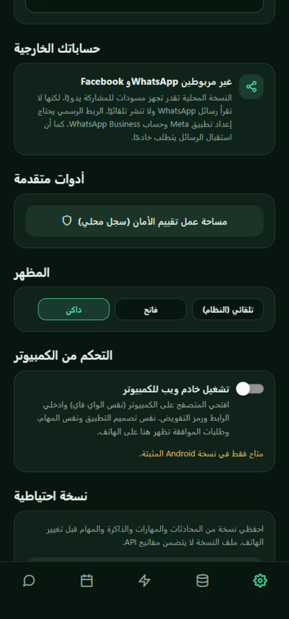
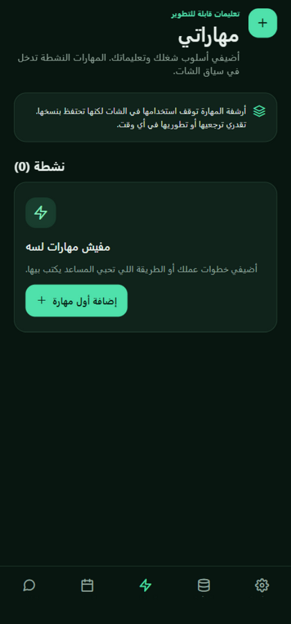
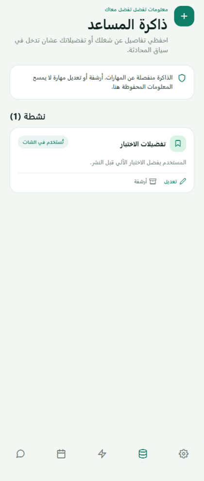
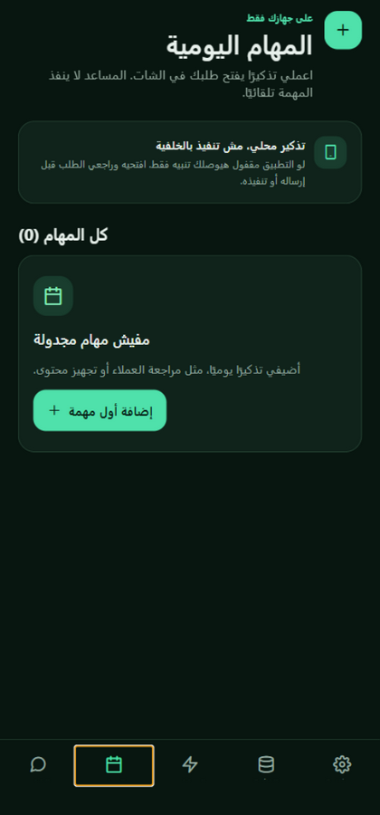
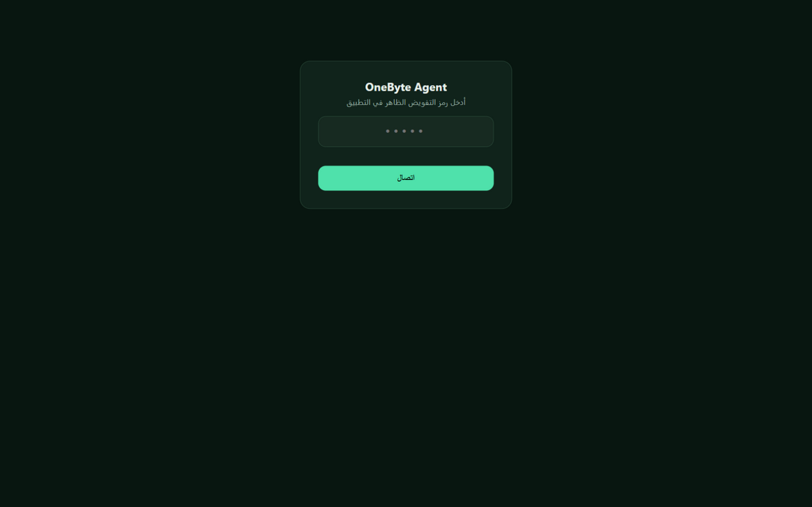
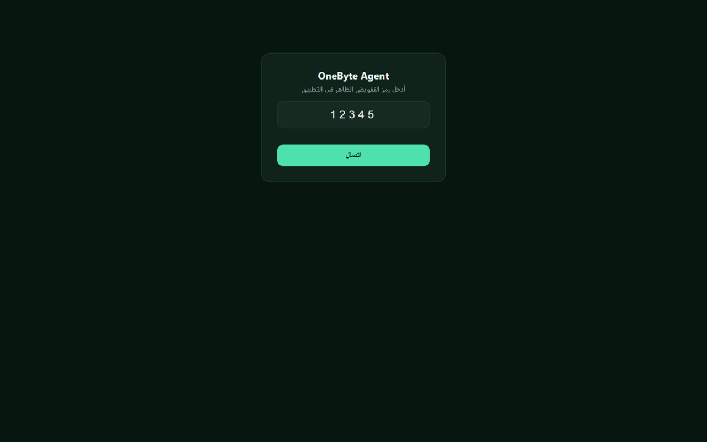
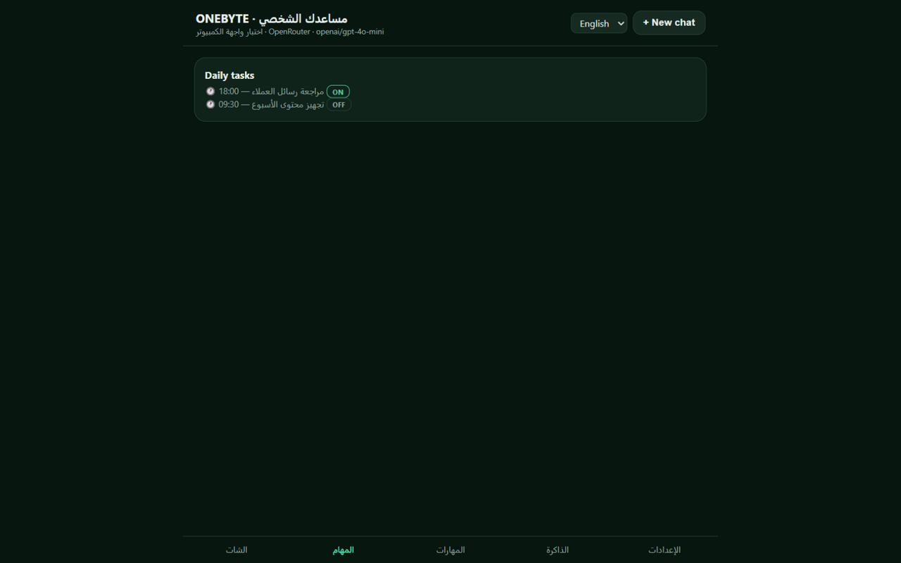

<div align="center">


</div>

<div dir="rtl" align="center">

# 🤖 OneByte Agent — مساعدك الشخصي على هاتفك

**ذكاءك وأدواتك وذاكرتك في شبكة واحدة — مساعد Android محليّ البيانات، يعمل مع مزود الذكاء الاصطناعي الذي تختاره.**

[](../../actions/workflows/build-apk.yml)
[](../../releases)
[]()
[]()

</div>

---

<div dir="rtl">

## ⚡ الهوية البصرية — Electric Spiderweb

شبكة كهربائية ثلاثية الأبعاد ترمز إلى تدفّق الإشارات بين **الموديل والأدوات والذاكرة**، مع مسارات سماوية وحمراء تلتقي عند نواة OneByte. الصورة في أعلى الصفحة تلخّص هذه الفكرة بألوان التصميم المرفق.

</div>

---

<div dir="rtl">

## ✨ ما هو OneByte Agent؟

تطبيق أندرويد (Expo / React Native) يحوّل أي موديل لغوي متوافق مع OpenAI إلى **وكيل ذكي (AI Agent)** يعمل لصالحك:

- 🗣️ **شات ذكي ببث مباشر (Streaming)** مع ضغط تلقائي للمحادثات الطويلة — المحادثة لا تنتهي أبدًا
- 📱 **تحكم حقيقي في الهاتف**: قراءة الشاشة، الضغط، الكتابة، التمرير، فتح التطبيقات — عبر خدمة Accessibility أصلية (Kotlin)
- 🌐 **أدوات ويب**: بحث DuckDuckGo + قراءة أي رابط — الموديل يجيب بمعلومات حديثة
- 🔐 **موافقة صريحة على كل إجراء خارجي** (مرة واحدة / حتى نهاية المهمة / رفض) — والحقول السرية مخفية ومحمية من الكتابة
- 🧠 **ذاكرة ومهارات** محفوظة محليًا تدخل تلقائيًا في سياق المحادثة
- ⏰ **مهام يومية** بتذكيرات محلية تفتح طلبك في الشات بضغطة واحدة
- 💻 **خادم كمبيوتر مدمج**: شغّل الخادم من الإعدادات وافتح نفس التطبيق من متصفح الكمبيوتر (نفس الواي فاي) بنفس التصميم والمهام
- 🎨 **ثيمات** فاتح/داكن/تلقائي + عرض كود منسق بزر نسخ + **مخططات Mermaid** بجماليات المصدر (classDef) وشجرة حقيقية تفاعلية + **معاينة كاملة** بمحرك ميرمايد الأصلي
- 💬 **واجهة شات بأسلوب ChatGPT**: رد المساعد نصّ سادة مع صف إجراءات أيقونية (نسخ/تقييم/قراءة/مشاركة)، ورسائل المستخدم بفقاعة خضراء أنيقة مع نسخ/تعديل تحتها، وزر الإرسال على اليمين مع الميكروفون والمايك يسارًا
- 🕘 **سجل المحادثات في الدرج الجانبي**: الآخر المحادثات كصف واحد + زر «محادثة جديدة» — والهيدر مضغوط على سطر واحد (زر الدرج + عنوان الجلسة + إجراءات)

</div>

---

## 📸 لقطات الشاشة

| الشات مع المخططات | المزودون الجاهزون + الفحص التلقائي | الثيم الداكن |
|:---:|:---:|:---:|
|  |  |  |

| المهارات | الذاكرة | المهام اليومية |
|:---:|:---:|:---:|
|  |  |  |

### 💻 نسخة الكمبيوتر (خادم الويب المدمج)

نفس التطبيق من متصفح الكمبيوتر على نفس الواي فاي — نفس التصميم، نفس المهام، حماية بـ PIN، والموافقات تظهر على الهاتف:

| شاشة الدخول (PIN) | الشات من الكمبيوتر | المهام بالإنجليزية |
|:---:|:---:|:---:|
|  |  |  |

---

<div dir="rtl">

## 📥 التثبيت (Android)

### الطريقة الأسهل — نزّل APK جاهز
1. افتح صفحة [**Releases**](../../releases)
2. نزّل `onebyte-agent-v1.1.0.apk` من أحدث إصدار
3. افتح الملف على الهاتف وفعّل **"التثبيت من مصادر غير معروفة**" إذا طُلب
4. ثبّت وافتحني!

> 🔔 التطبيق يطلب صلاحيتين فقط: **الإنترنت** و**الاهتزاز** + إشعارات (اختيارية للتذكيرات). لا يطلب موقعًا ولا مايكروفون ولا جهات اتصال.

### من المصدر (GitHub Actions)
```bash
git clone https://github.com/elssoliman86-codesoli/onebyte-agent.git
cd onebyte-agent
npm ci
npx expo start          # للتطوير
```
أو ابنِ APK سحابيًا: اعمل Fork ثم شغّل workflow **Build Android APK** من تبويب Actions — والـ APK يظهر كـ Artifact.

</div>

---

<div dir="rtl">

## 🚀 الإعداد بعد التثبيت (3 خطوات)

1. **اربط المزود**: الإعدادات ← اختر مزودًا جاهزًا بكبسة (OpenRouter, DeepSeek, Gemini, Claude, Qwen, NVIDIA, Groq, GMI… أو أي رابط OpenAI-compatible) ← الصق مفتاح API ← **اختيار من قائمة الموديلات** (مع الأسعار والمجاني)
   - الفحص التلقائي يعرض **كود HTTP** جنب كل موديل — `200 ✓` تعني شغّال، `401` مفتاح خاطئ، `429` تجاوزت الحد
2. **فعّل التحكم في الهاتف** (اختياري): الإعدادات ← مفتاح التحكم ← "تفعيلها من إعدادات النظام" ← اختر OneByte Agent ← وافق
3. **ابدأ الشات!** جرّب: *"افتحي واتساب وابعتي رسالة لـ X"* — كل إجراء هيظهر لك في نافذة موافقة قبل التنفيذ

### أوامر سريعة في الشات
| الأمر | الوظيفة |
|---|---|
| `/help` | كل الأوامر |
| `/skill اسم` | تحميل مهارة محفوظة مع طلبك |
| `/mcp` | عرض الأدوات المتصلة وحالتها |
| `/new` `/settings` `/tasks` `/skills` `/memory` | تنقل سريع |

### خادم الكمبيوتر
الإعدادات ← **التحكم من الكمبيوتر** ← شغّل الخادم ← افتح الرابط الظاهر (`http://IP:8089`) من متصفح الكمبيوتر على نفس الواي فاي ← أدخل الرمز (PIN) الظاهر في التطبيق. نفس الواجهة، نفس المهام، وطلبات الموافقة تظهر على هاتفك.

</div>

---

<div dir="rtl">

## 🔒 الخصوصية والأمان

- **مفتاح API في خزنة الجهاز** (`expo-secure-store` مع `WHEN_UNLOCKED_THIS_DEVICE_ONLY`) — لا يغادر الهاتف أبدًا
- **لا سيرفر، لا حساب، لا تتبع** — كل المحادثات/المهارات/الذاكرة في تخزين محلي
- الرسائل تذهب **مباشرة** من هاتفك إلى المزود الذي اخترته
- الموافقة **لكل أداة على حدة** — الموافقة على أداة لا تفتح غيرها
- كلمات المرور **لا تُقرأ** في لقطات الشاشة و**يُرفض الكتابة** فيها
- نظام مواجهة حقن الأوامر: التعليمات داخل محتوى الشاشة تُتجاهل
- نسخة احتياطية بالتصدير — **بدون** المفتاح

## 🏗️ البنية التقنية

```
app/(tabs)/          شاشات Expo Router (شات، مهام، مهارات، ذاكرة، إعدادات)
src/agent.ts         حلقة الوكيل: نموذج ← موافقة ← أداة ← نموذج (بث SSE)
src/tools.ts         12 أداة: محلية + ذاكرة + ويب + تحكم جهاز
src/model-provider.ts بروتوكول OpenAI-compatible + برومبت النظام
src/context.ts       تقدير التوكنز + الضغط التلقائي للسياق
src/pc-server.ts     خادم الويب المصاحب للكمبيوتر
modules/device-control/  كود Kotlin أصيل (خدمة Accessibility + خادم PC)
.github/workflows/   بناء APK تلقائيًا على GitHub Actions
```

## 🛠️ المزايا التقنية البارزة

- **بث SSE كامل** مع تجميع tool_calls المتقطعة وحالات fallback للاستجابات غير المتدفقة
- **فحص الموديلات تلقائيًا**: `/v1/models` مع توحيد الأسعار بين المزودين (لكل-توكن ↔ لكل-مليون)
- **ضغط تدريجي للسياق**: تقسيم الرسائل القديمة لدفعات وتلخيصها دون تجاوز نافذة الموديل — مع بحث كامل في الأصل (`search_history`)
- **عرض Mermaid بجماليات المصدر**: يقرأ `classDef`/`class`/`:::class` من الكود نفسه — ألوان العقد كما كتبها المؤلف — وشجرة `TD` فعلية بأعمدة تتناسب مع طول كل فرع، مع عقدة تُضغط تبرز حوافها، والحلقات والوصلات الراجعة مذكورة تحته صراحةً
- **معاينة كاملة بالمحرك الأصلي**: زر يرسم المخطط بمكتبة mermaid.js الرسمية (WebView على Android، iframe مدمج على الويب — المستخدم في نسخة الكمبيوتر) في «معاينة حية» بكامل التفاصيل
- **طلبات الموديل بلا مهلة زمنية**: انتظار كامل للمزودين البطيئين (فحص الموديلات، بث الشات، لوب أدوات الوكيل) مع إمكانية الإلغاء من واجهة الشات

## 🤝 المساهمة

المشكلات والاقتراحات مرحب بها في [Issues](../../issues). المساهمات عبر Pull Requests.

## 📄 الترخيص

MIT — انظر [LICENSE](LICENSE)

</div>

---

<div dir="rtl" align="center">

**صُنع بـ ❤️ ليكون مساعدك الشخصي — بياناتك ملكك**

⭐ لو أعجبك المشروع، اترك نجمة!

</div>
